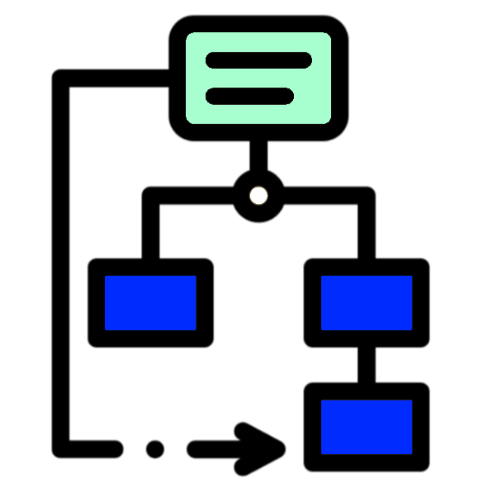
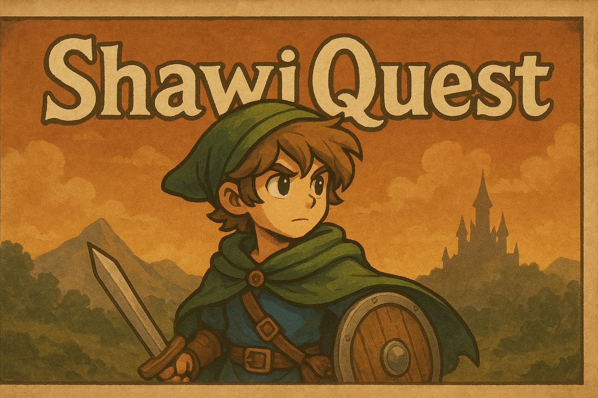
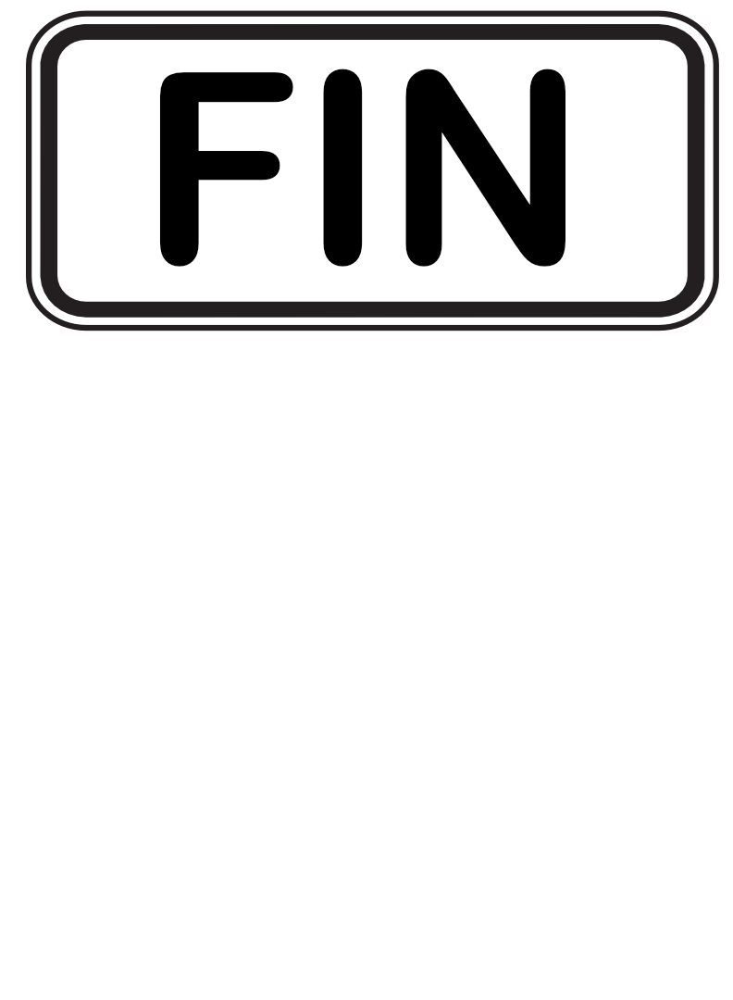

<p align="Center"></p>
<h4 align="Center">1SY - Analyse Objet</h4>
<p align="Center"></p>

# 🏋🏻‍♂️ ShawiQuest

Dans cet atelier vous devez programmer, en mode versions distinctes, une toute petite partie d'un jeu de rôle.

## Version 1.0 - À l'attaque !

Votre programme devra permettre à l'utilisateur d'appuyer sur `d` pour créer des dommages au joueur ou sur `h` pour guérir, en partie, le joueur.
### Classe `Player`
Un joueur avec un nom (`Name`) et une ligne de vie entre 0 et 100 (`HealthPoints`).  Quand le joueur arrive à 0 (jamais plus bas), il meurt.  On peut lui faire des dommages (`TakesDamage`) entre 10 et 40 au hasard et le guérir (`Heal`) entre 5 et 20 au hasard.
### Affichage attendu
```plaintext
Press 'd' to take damage, 'h' to heal

Player: Madrid Lezore, Damage: 38, HealthPoints: 62

Player: Madrid Lezore, Heal: 8, HealthPoints: 70

Player: Madrid Lezore, Damage: 13, HealthPoints: 57

Player: Madrid Lezore, Heal: 11, HealthPoints: 68

Player: Madrid Lezore, Heal: 9, HealthPoints: 77

Player: Madrid Lezore, Damage: 15, HealthPoints: 62

Player: Madrid Lezore, Heal: 9, HealthPoints: 71

Player: Madrid Lezore, Damage: 13, HealthPoints: 58

Player: Madrid Lezore, Damage: 36, HealthPoints: 22

Player: Madrid Lezore, Heal: 6, HealthPoints: 28

Player: Madrid Lezore, Damage: 22, HealthPoints: 6

Player: Madrid Lezore, Damage: 16, HealthPoints: 0

Game Over! 

Press any key to replay...
```
> ⚠️ Présentez votre solution à l'enseignant pour obtenir les points associés.

# À suivre, après la pause...

<!--
## Version 1.1 - La ligne de vie
Vous devez maintenant programmer la barre de vie qui apparaîtrait en haut de l'écran du jeu...
### Classe `HealthBar`
Une classe qui s'occupe seulement d'afficher l'état de santé du joueur dans une barre rouge ou verte conformément à l'exemple d'affichage.
### Affichage attendu
```plaintext
Press 'd' to take damage, 'h' to heal
Red Health Bar : 90 (Lost 10 HP)
Player: Madrid Lezore, Damage: 10, HealthPoints: 90

Green Health Bar : 97 (Gained 7 HP)
Player: Madrid Lezore, Heal: 7, HealthPoints: 97

Red Health Bar : 82 (Lost 15 HP)
Player: Madrid Lezore, Damage: 15, HealthPoints: 82

Green Health Bar : 90 (Gained 8 HP)
Player: Madrid Lezore, Heal: 8, HealthPoints: 90

Red Health Bar : 62 (Lost 28 HP)
Player: Madrid Lezore, Damage: 28, HealthPoints: 62

Red Health Bar : 22 (Lost 40 HP)
Player: Madrid Lezore, Damage: 40, HealthPoints: 22

Red Health Bar : 0 (Lost 28 HP)
Player: Madrid Lezore, Damage: 28, HealthPoints: 0

Game Over! 

Press any key to replay...
```
> ⚠️ Présentez votre solution à l'enseignant pour obtenir les points associés. 

## Version 1.2 - La trame sonore
On vous demande maintenant d'ajouter du son à l'application selon que le joueur reçoive un coup ou se guérisse.

### Classe `SoundManager`
Une gestionnaire qui s'occupe d'émettre un "son" selon que le joueur a été blessé ou guérit selon l'affichage proposé.

```plaintext
Press 'd' to take damage, 'h' to heal

Play Hurt Sound !
Red Health Bar : 87 (Lost 13 HP)
Player: Madrid Lezore, Damage: 13, HealthPoints: 87

Play Hurt Sound !
Red Health Bar : 53 (Lost 34 HP)
Player: Madrid Lezore, Damage: 34, HealthPoints: 53

Play Heal Sound !
Green Health Bar : 67 (Gained 14 HP)
Player: Madrid Lezore, Heal: 14, HealthPoints: 67

Play Hurt Sound !
Red Health Bar : 48 (Lost 19 HP)
Player: Madrid Lezore, Damage: 19, HealthPoints: 48

Play Heal Sound !
Green Health Bar : 63 (Gained 15 HP)
Player: Madrid Lezore, Heal: 15, HealthPoints: 63

Play Heal Sound !
Green Health Bar : 73 (Gained 10 HP)
Player: Madrid Lezore, Heal: 10, HealthPoints: 73

Play Hurt Sound !
Red Health Bar : 46 (Lost 27 HP)
Player: Madrid Lezore, Damage: 27, HealthPoints: 46

Play Hurt Sound !
Red Health Bar : 19 (Lost 27 HP)
Player: Madrid Lezore, Damage: 27, HealthPoints: 19

Play Hurt Sound !
Red Health Bar : 0 (Lost 38 HP)
Player: Madrid Lezore, Damage: 38, HealthPoints: 0

Game Over! 

Press any key to replay...
```

> ⚠️ Présentez votre solution à l'enseignant pour obtenir les points associés. 

## Version 2.0 - Merci Observer !
Reprennez l'énoncé complet de la version 1 (1.0 à 1.3) et reprogrammez l'application en utilisant le pattert `Observer` et en respectant les `PACOO`.

> ⚠️ Présentez votre solution à l'enseignant pour obtenir les points associés. 

## Version 2.1 - Merci mon ami !
Vous devez ajouter à votre application un compagnon qui sera informé des changements de points de vie du joueur et qui déclenchera la méthode `Heal` de ce dernier, une fois, si l'espérance de vie du joueur est en deça de 50%.

### Classe `AICompagnon`
Un compagnon AI qui va guérir le joueur s'il commence à être trop faible.

```plaintext
Press 'd' to take damage, 'h' to heal

Red Health Bar : 69 (Lost 31 HP)
Play Hurt Sound !
Player: Madrid Lezore, Damage: 31, HealthPoints: 69

Red Health Bar : 50 (Lost 19 HP)
Play Hurt Sound !
Player: Madrid Lezore, Damage: 19, HealthPoints: 50

Red Health Bar : 33 (Lost 17 HP)
Play Hurt Sound !
Green Health Bar : 42 (Gained 9 HP)
Play Heal Sound !
Player: Madrid Lezore, Heal: 9, HealthPoints: 42
AI Companion: Healing you!
Player: Madrid Lezore, Damage: 17, HealthPoints: 42

Red Health Bar : 5 (Lost 37 HP)
Play Hurt Sound !
Green Health Bar : 18 (Gained 13 HP)
Play Heal Sound !
Player: Madrid Lezore, Heal: 13, HealthPoints: 18
AI Companion: Healing you!
Player: Madrid Lezore, Damage: 37, HealthPoints: 18

Red Health Bar : 0 (Lost 40 HP)
Play Hurt Sound !
Player: Madrid Lezore, Damage: 40, HealthPoints: 0

Game Over! 

Press any key to continue...
```
> ⚠️ Présentez votre solution à l'enseignant pour obtenir les points associés. 

> ⚠️ Remettez un zip de vos solutions sur Léa.
 -->
<hr><p align="Center"></p>
