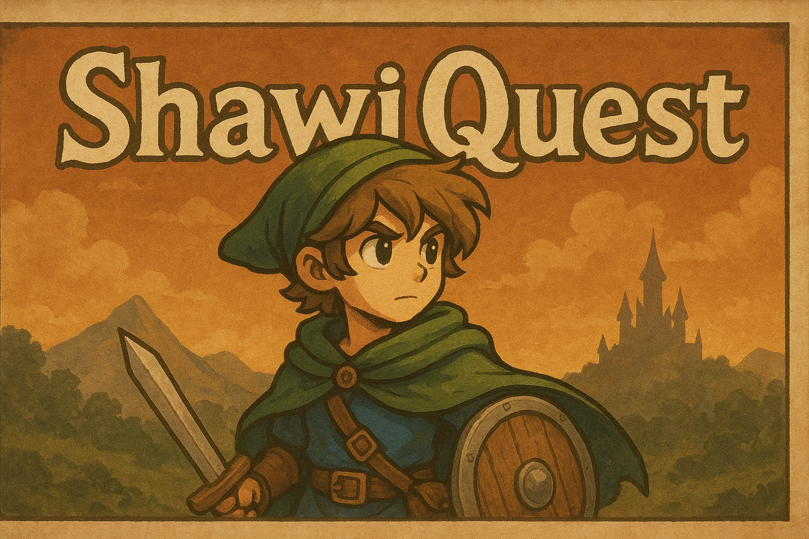

<p align="Center"></p>
<h4 align="Center">1SY - Analyse Objet</h4>
<p align="Center"></p>

# 🏋🏻‍♂️ ShawiQuest Arena

Simulation fonctionnelle d'un jeu de rôle en mode duel.

## Mandat

Deux joueurs s’affrontent à tour de rôle sur la même console. Créez deux instances distinctes de la classe `Player`. Chacune possède ses propres HP et sa propre arme équipée. La même logique de jeu sert aux deux participants, qui deviennent tour à tour attaquant et adversaire.

Développez le jeu complet avec trois armes (Quel'Serrar, Arcanite Reaper et Shadowmourne) et trois options (Fiery Weapon, Berserking et Crusader).

Votre travail sera évalué sur son fonctionnement et sur votre capacité à utiliser correctement les design patterns. Vous devrez notamment expliquer comment votre conception permet d’ajouter une arme, un enchantement ou une réaction au résultat d’une attaque.

Les noms d’armes et d’options proviennent de *World of Warcraft*. Les probabilités, les dégâts et le cumul des effets suivent les règles de ce TP.

## 1. Faire jouer une partie complète

### Configurer les deux participants

Avant le premier tour, configurez **Joueur1**, puis **Joueur2**. Pour chacun, demandez son **nom** et son **mode de contrôle** : Humain ou Ordinateur.

### Jouer un tour

| État initial de chaque joueur | Valeur |
| --- | --- |
| Points de vie | 100 HP |
| Inventaire | Quel'Serrar (équipée), Arcanite Reaper et Shadowmourne |

Le joueur 1 commence. Au début de chaque tour, affichez le nom du joueur actif, son arme et les HP des deux joueurs. Le joueur actif peut changer son arme avant de préparer son coup.

Pour un **humain**, recueillez les décisions au clavier. Pour un **ordinateur**, le programme choisit une arme et une combinaison valide d’options, puis confirme automatiquement. Une sélection aléatoire parmi les choix valides suffit. Affichez ses décisions pour que les participants puissent suivre le duel. Lorsque les deux joueurs sont contrôlés par l’ordinateur, la partie se déroule jusqu’à la victoire sans saisie supplémentaire.

À la confirmation, résolvez une attaque contre l’autre joueur. Affichez le résultat de chaque coup. Dès que la cible atteint 0 HP, annoncez le gagnant et terminez le duel. Les HP ne descendent jamais sous zéro. Si les deux joueurs sont encore en vie, échangez leurs rôles : l’adversaire dispose maintenant d’un tour complet pour préparer sa propre attaque.

### Durée d’un duel entre deux ordinateurs

Visez **10 tours de jeu en moyenne pour une durée totale d’environ 30 secondes**. Un tour correspond à l’action d’un seul joueur. Le duel prend fin dès qu’un joueur atteint 0 HP, que ce soit avant ou après le dixième tour.

À chaque tour du duel automatique, l’ordinateur choisit au hasard parmi les trois armes avec des poids de 5 pour Quel'Serrar, 1 pour Arcanite Reaper et 1 pour Shadowmourne. Tant que la réserve commune contient des charges, l’ordinateur choisit d’enchanter son arme avec une probabilité de 10 %. Dans ce cas, il choisit uniformément entre un effet et le maximum permis par les charges restantes et la limite par attaque, puis tire chaque effet indépendamment parmi les trois types. Un type déjà tiré reste disponible pour le choix suivant.

Affichez les choix de l’ordinateur, **attendez 3 secondes**, puis résolvez le tour et affichez son résultat. Dans la boucle asynchrone du mode Ordinateur–Ordinateur, utilisez `await Task.Delay(TimeSpan.FromSeconds(GameSettings.AutoTurnDelaySeconds));` une seule fois par tour, y compris au dernier tour. Un duel de 8 tours comporte ainsi 24 secondes d’attente, un duel de 10 tours en comporte 30. Les parties avec un humain avancent au rythme de ses décisions.

## 2. Choisir son arme

Au moment de créer une attaque, il faut obtenir la force, `Strength (r)` de l'attaque **10 à 20 inclusivement**.

Calculez les dégâts de l’arme au moment du coup. Notez `r` le tirage de départ. Pour chaque joueur, les **HP manquants** valent les HP de départ moins les HP actuels. Utilisez les HP **avant** le coup. Toutes les divisions ci-dessous sont des divisions entières.

| Arme | Réussite | Algorithme des dégâts avant options |
| --- | ---: | --- |
| **Quel'Serrar** | 100 % | L’épée devient plus forte à mesure que son porteur est blessé. Par tranche complète de 20 HP manquants chez l’attaquant, ajoutez 1 dégât, jusqu’à 4 points de bonus. Dégâts = `r + 1 + min(4, HP manquants de l’attaquant / 20)`. |
| **Arcanite Reaper** | 75 % | Calculez d’abord `r + r / 2`. Ajustez ensuite selon la qualité du tirage. De 10 à 12, retranchez 2 (coup éraflant). De 13 à 16, gardez le résultat. De 17 à 20, ajoutez 4 (coup appuyé). |
| **Shadowmourne** | 50 % | La hache exploite les blessures de sa cible. Doublez le tirage, puis ajoutez 3 dégâts par tranche complète de 20 HP déjà perdus par la cible. Dégâts = `2 × r + 3 × (HP manquants de la cible / 20)`. |

Pour les armes susceptibles de rater, tirez la réussite indépendamment des dégâts. Un échec vaut zéro. Sur une réussite, les options transforment le résultat de l’arme dans l’ordre choisi. Limitez ensuite la perte réelle aux HP restants de la cible.

**Exemple comparatif.** L’attaquant possède 55 HP, la cible 35 HP et le tirage vaut 17. Sans enchantement, un coup réussi de Quel'Serrar vaut **20** (17 + 1 + 2), celui d’Arcanite Reaper **29** (17 + 8 + 4) et celui de Shadowmourne **43** (34 + 3 × 3). Dans ce dernier cas, le journal annonce une perte réelle de **35 HP**.

## 3. Préparer le coup avant de le confirmer

Les deux joueurs se partagent **5 charges d’enchantement pour toute la partie**. Chaque effet appliqué coûte une charge. Par exemple, si J1 confirme Fiery Weapon et Berserking, il reste 3 charges pour la suite du duel. Affichez la réserve commune au début de chaque tour. À zéro, les deux joueurs poursuivent le combat avec leurs armes ordinaires.

Au début de la préparation, présentez l’arme équipée sans enchantement. Le joueur peut choisir de **zéro à trois options par tour**, dans la limite des charges disponibles. Il peut combiner des effets différents ou choisir deux ou trois fois le même. Chaque sélection occupe une place et coûte une charge à la confirmation. Appliquez les effets un à un dans l’ordre choisi et affichez cet ordre après chaque ajout.

| Enchantement | Effet sur les dégâts obtenus jusque-là | Nom affiché |
| --- | --- | --- |
| Fiery Weapon | Ajoute 3. | « Fiery Weapon » |
| Berserking | Multiplie par 2. | « Berserking » |
| Crusader | Sur un coup réussi, porte les dégâts à 15 si leur valeur actuelle est inférieure à 15. Sinon, conserve cette valeur. | « Crusader » |

Le menu doit offrir deux actions distinctes.

- **Recommencer la préparation** efface les options du coup en cours sans consommer de charge. Le joueur retrouve son arme de base. Les HP restent identiques et l’adversaire attend.
- **Confirmer** déduit une charge par effet choisi et déclenche une seule attaque. Un coup raté consomme les charges confirmées. À son prochain tour, le joueur retrouve son arme de base et peut choisir de nouveaux options.

L’ordre choisi doit être visible dans le nom et dans le calcul. Voici les résultats attendus avec un tirage de **10** et des coups réussis alors que les deux joueurs ont tous leurs HP.

| Arme préparée | Calcul | Dégâts |
| --- | --- | ---: |
| Quel'Serrar — Fiery Weapon → Berserking | (11 + 3) × 2 | 28 |
| Quel'Serrar — Berserking → Fiery Weapon | (11 × 2) + 3 | 25 |
| Shadowmourne — Fiery Weapon → Berserking | (10 × 2 + 3) × 2 | 46 |
| Shadowmourne — Berserking → Fiery Weapon | ((10 × 2) × 2) + 3 | 43 |
| Quel'Serrar — Fiery Weapon → Fiery Weapon → Fiery Weapon | 11 + 3 + 3 + 3 | 20 |
| Quel'Serrar — Fiery Weapon → Berserking → Fiery Weapon | (11 + 3) × 2 + 3 | 31 |
| Quel'Serrar — Crusader → Fiery Weapon → Berserking | (max(11, 15) + 3) × 2 | 36 |
| Quel'Serrar — Fiery Weapon → Berserking → Crusader | max((11 + 3) × 2, 15) | 28 |

## 4. Réagir aux attaques et aux blessures

Le **journal** observe les HP des deux joueurs. À chaque blessure, il identifie le joueur touché et affiche sa perte réelle et ses HP restants. Si le joueur 2 possède 2 HP et reçoit un coup de 3 dégâts, le journal annonce une perte de 2 HP.

Le journal observe aussi le résultat de chaque attaque confirmée. Sur un échec, il affiche le nom de l’attaquant et la mention « attaque ratée ». Les HP des deux joueurs restent identiques, les charges confirmées sont dépensées et le tour passe à l’adversaire.

<!-- ## 5. Concevoir la solution

Mobilisez les quatre patrons étudiés. Dans votre diagramme et votre code, on doit pouvoir suivre ces décisions :

- **Strategy** — `Player.EquippedWeapon` est de type `IWeapon`. Chaque arme concrète implémente sa propre règle de réussite et de dégâts. Changer d’arme remplace la stratégie en cours.
- **Decorator** — Chaque enchantement implémente également `IWeapon`, enveloppe une autre arme et modifie uniquement les dégâts d’un coup réussi. Il transmet la description des effets dans l’ordre choisi.
- **Builder** — À partir de l’arme équipée, le constructeur prépare une arme décorée pour ce tour. Il gère les effets facultatifs, leur ordre, les répétitions et le coût en charges.

- **Observer** — Le joueur publie le résultat de son attaque. Le journal s’y abonne pour afficher l’issue du coup. Il observe aussi les changements de HP des deux joueurs pour signaler les blessures. Un événement C# ou une interface d’observation conviennent.

Les deux participants sont des instances de la même classe `Player`. Le mode de contrôle détermine qui prend les décisions. Les choix saisis au clavier et les choix de l’ordinateur passent par le même constructeur d’attaque et le même moteur de combat. Vous choisissez les noms des autres classes et interfaces. Gardez la lecture du clavier et l’affichage du menu distincts des règles du combat pour pouvoir vérifier un calcul sans rejouer toute une partie.

### Architecture proposée pour une attaque

Les deux instances de `Player` utilisent le même mécanisme d’attaque. Le joueur conserve son arme de base entre les tours. Le Builder prépare une version temporairement enchantée de cette arme pour le coup en cours.

| Classe ou interface | Responsabilité |
| --- | --- |
| `Duel` | Gère les tours et les charges communes. À la confirmation, il déduit le coût une seule fois et appelle `attacker.Attack(target, preparedAttack)`. |
| `Player` | Conserve son arme dans `EquippedWeapon`. Dans `Attack`, tire la valeur initiale et appelle une fois `preparedAttack.Weapon.Resolve(context)`. Applique le résultat à la cible, puis publie `AttackResolved`. |
| `IWeapon` | Contrat commun des stratégies et des décorateurs. Expose une description et `AttackResult Resolve(AttackContext context)`. Le contexte en lecture seule contient le tirage et les HP de l’attaquant et de la cible avant le coup. Le résultat contient `IsHit` et `Damage`. |
| `QuelSerrar`, `ArcaniteReaper`, `Shadowmourne` | Trois stratégies concrètes. L’arme de base résout la réussite et calcule les dégâts initiaux du coup. |
| `WeaponDecorator` | Contient une autre `IWeapon`. `FieryWeapon`, `Berserking` et `Crusader` appellent une seule fois son `Resolve(context)`. Ils propagent un échec tel quel ou transforment les dégâts en cas de réussite. |
| `AttackBuilder` et `PreparedAttack` | Le Builder reçoit `attacker.EquippedWeapon` et enveloppe les options successifs autour de cette arme. `Build()` retourne l’arme préparée et le nombre de charges à dépenser. |
| `CombatLog` | Observe `AttackResolved` et `HealthChanged` chez les deux joueurs pour afficher les résultats et les pertes réelles de HP. |

**Exemple.** J1 équipe Quel'Serrar et prépare Fiery Weapon, puis Berserking. Le Builder produit l’équivalent de `new Berserking(new FieryWeapon(quelSerrar))`. Avec un attaquant à 100 HP et un tirage de 10, Quel'Serrar calcule 11, Fiery Weapon porte le résultat à 14 et Berserking le double. J2 reçoit **28 dégâts**. Au prochain tour de J1, Quel'Serrar est toujours équipée et la préparation repart de zéro.

### Centraliser les constantes du jeu

Dans le fichier `GameSettings.cs`, créez une classe statique qui regroupe les constantes du duel. Utilisez ces constantes pour initialiser les joueurs, résoudre les attaques et afficher les valeurs dans le menu. Les HP actuels, l’équipement choisi et la préparation du coup appartiennent à chaque joueur.

```csharp
public static class GameSettings
{
  // Duel et tirage inclusif
  public const int PlayerCount = 2;
  public const int StartingHealth = 100;
  public const int MinimumHealth = 0;
  public const int MinAttackRoll = 10;
  public const int MaxAttackRoll = 20;
  public const int MissDamage = 0;

  // Rythme et choix des ordinateurs en duel automatique
  public const int TargetAutoDuelTurns = 10;
  public const double TargetAutoDuelSeconds = 30;
  public const double AutoTurnDelaySeconds = TargetAutoDuelSeconds / TargetAutoDuelTurns;
  public const int AutoQuelSerrarWeight = 5;
  public const int AutoArcaniteReaperWeight = 1;
  public const int AutoShadowmourneWeight = 1;
  public const double AutoEnchantChance = 0.10;

  // Armes : probabilités entre 0 et 1
  public const double QuelSerrarHitChance = 1.0;
  public const int QuelSerrarDamageBonus = 1;
  public const int QuelSerrarMissingHealthStep = 20;
  public const int QuelSerrarMaxWoundBonus = 4;
  public const double ArcaniteReaperHitChance = 0.75;
  public const int ArcaniteReaperHalfRollDivisor = 2;
  public const int ArcaniteReaperGrazeMaxRoll = 12;
  public const int ArcaniteReaperGrazePenalty = 2;
  public const int ArcaniteReaperHeavyMinRoll = 17;
  public const int ArcaniteReaperHeavyBonus = 4;
  public const double ShadowmourneHitChance = 0.50;
  public const int ShadowmourneDamageMultiplier = 2;
  public const int ShadowmourneMissingHealthStep = 20;
  public const int ShadowmourneDamagePerStep = 3;

  // options
  public const int EnchantmentChargesPerDuel = 5;
  public const int MaxEnchantmentsPerAttack = 3;
  public const int FieryWeaponDamageBonus = 3;
  public const int BerserkingMultiplier = 2;
  public const int CrusaderMinimumDamage = 15;
}
```

Au début de chaque duel, initialisez la réserve commune avec `GameSettings.EnchantmentChargesPerDuel`. Le solde courant appartient à la partie.

Deux paramètres peuvent avoir la même valeur tout en représentant des règles indépendantes. Par exemple, modifier le multiplicateur du décorateur Berserking doit uniquement affecter les armes qui portent cet enchantement.

## 6. Vérifier le résultat

### Partie de référence

Pour reproduire la partie, configurez deux joueurs humains et imposez les tirages et les résultats de réussite indiqués dans votre test. Les deux joueurs commencent à 100 HP.

| Tour | Action | Tirage | Calcul des dégâts | HP J1 | HP J2 |
| --- | --- | ---: | --- | ---: | ---: |
| 1 | J1, Arcanite Reaper réussie, Fiery Weapon puis Berserking | 10 | (10 + 5 − 2 + 3) × 2 = 32 | 100 | 68 |
| 2 | J2, Shadowmourne réussie | 17 | 17 × 2 = 34 | 66 | 68 |
| 3 | J1, Quel'Serrar, Fiery Weapon puis Berserking | 20 | (20 + 1 + 1 + 3) × 2 = 50 | 66 | 18 |
| 4 | J2, Arcanite Reaper réussie | 13 | 13 + 6 = 19 | 47 | 18 |
| 5 | J1, Quel'Serrar | 10 | 10 + 1 + 2 = 13 | 47 | 5 |
| 6 | J2, Shadowmourne ratée avec Fiery Weapon | 18 | 0 | 47 | 5 |
| 7 | J1, Quel'Serrar | 14 | 14 + 1 + 2 = 17 | 47 | 0 |

La réserve passe de 5 à 3 charges au tour 1, puis à 1 au tour 3. J2 dépense la dernière charge au tour 6 malgré son échec. Au dernier tour, le journal indique une perte réelle de 5 HP. J1 gagne avec 47 HP.

### Autres cas à démontrer

Sauf indication contraire, commencez chaque test avec les deux joueurs à 100 HP.

- Vérifiez les deux aspects du rythme. Simulez une série de duels sans attente pour mesurer le nombre moyen de tours, puis chronométrez trois duels à l’écran avec l’attente activée. Consignez dans le README la moyenne de tours simulés et, pour chaque duel affiché, sa durée et son nombre de tours. La cible de 30 secondes est une moyenne sur plusieurs parties.

- Lancez chacune des quatre combinaisons de modes. Vérifiez que J1 commence, que seuls les humains sont invités à saisir leurs choix et que le gagnant est annoncé par son nom. Dans un duel entre deux ordinateurs, vérifiez que la partie se termine sans intervention après la configuration.

- Pour vérifier la centralisation, passez temporairement `QuelSerrarDamageBonus` de 1 à 4 et recompilez. Avec un tirage imposé de 12, le joueur utilisant Quel'Serrar sans enchantement doit infliger 16 dégâts. Rétablissez ensuite la valeur de 1 pour la partie de référence.

- Avec Quel'Serrar sans enchantement, vérifiez les bornes du tirage. Quel'Serrar donne 11 dégâts avec 10 et 21 dégâts avec 20.
- Avec un tirage identique de 15, vérifiez les dégâts de Quel'Serrar, de Arcanite Reaper et de Shadowmourne sur un coup réussi sans enchantement : 16, 22 et 30 respectivement. Vérifiez aussi les changements de palier : pour Arcanite Reaper, les tirages 12, 13, 16 et 17 donnent 16, 19, 24 et 29 dégâts. Pour les deux autres armes, comparez 19 et 20 HP manquants chez le joueur concerné. Forcez ensuite un échec pour Arcanite Reaper et Shadowmourne. Le joueur inflige 0 dans les deux cas.
- Avec deux joueurs à 100 HP, faites rater J1. Vérifiez que le journal annonce un seul échec, que les deux joueurs conservent 100 HP et que J2 commence son tour.
- Avec Shadowmourne, Fiery Weapon et un tirage de 10, un coup réussi vaut 23. En cas d’échec, le joueur inflige 0.
- Dans deux tests indépendants, chacun avec une réserve neuve, utilisez un tirage de 10. Vérifiez les deux ordres des trois options sur Quel'Serrar. Les résultats attendus sont 36 et 28.
- Avec une seule charge disponible, préparez Fiery Weapon et tentez d’ajouter Berserking. Le deuxième ajout est refusé. Recommencez la préparation : la charge reste disponible. Confirmez un seul effet : le solde passe à zéro pour les deux joueurs. Vérifiez qu’une nouvelle partie débute avec cinq charges.
- Avec une réserve neuve, préparez trois fois Fiery Weapon et tentez un quatrième ajout. Seuls les trois premiers sont retenus. Avec un tirage de 10 et Quel'Serrar, confirmez et vérifiez les 20 dégâts et les 2 charges restantes.
- Vérifiez le retour à Quel'Serrar après avoir équipé Shadowmourne et la fin de partie lorsque le joueur perd ses derniers HP.

## 7. Remise

Remettez une archive ZIP comprenant les éléments suivants.

1. **Solution Visual Studio** — Incluez le fichier `.slnx`, le projet console `.csproj` et les sources nécessaires. Vérifiez que la solution compile et démarre après extraction.
2. **Diagramme de classes UML** — Montrez les classes et interfaces qui participent aux quatre patrons ainsi que leurs relations. Fournissez un diagramme lisible en PDF ou en image.
3. **Fichier README.md** — Indiquez comment lancer le jeu. Pour chaque patron, nommez les classes concernées et expliquez leur collaboration à partir d’une action du joueur. Consignez vos vérifications dans un tableau précisant le scénario, le résultat attendu et le résultat observé. Les vérifications peuvent être manuelles ou automatisées.

## Grille de correction

| Critère | Éléments évalués | Points |
| --- | --- | ---: |
| Déroulement du combat | Configuration du nom et du mode des deux joueurs (2), alternance des tours entre deux instances de `Player` (1), durée du duel entre ordinateurs (1), gestion des HP et fin de partie (2). | 6 |
| Stratégies d’arme | Tirage inclusif, calcul propre aux trois armes et traitement du coup raté (3), délégation à l’arme équipée (2), changement et conservation de cette arme (1). | 6 |
| Armes et options | Application des effets sur un coup réussi (2), composition des trois décorateurs sur les trois armes (2), exactitude des noms et des dégâts selon l’ordre choisi (2). | 6 |
| Construction du coup | Préparation progressive et aperçu (2), répétitions autorisées et respect des limites par tour et par duel (2), reprise et confirmation avec exécution unique (2). | 6 |
| Réactions aux événements | Abonnement du journal aux deux joueurs (1), notification unique par attaque confirmée (1), affichage des échecs (1), journal des pertes réelles de HP (2). | 5 |
| Qualité de la solution C# | Compilation et lancement après extraction (1), séparation du menu et des règles (1), centralisation des constantes dans `GameSettings` (1), lisibilité et cohérence des noms (1). | 4 |
| UML et justification | Relations UML conformes au code (2), explications des quatre patrons appuyées sur une action du jeu (2). | 4 |
| Vérifications | Partie de référence documentée (1), cas limites et résultats observés documentés (2). | 3 |
| **Total** | **Travail valant 40 % de la note finale du cours** | **40** | -->

<hr><p align="Center"></p>