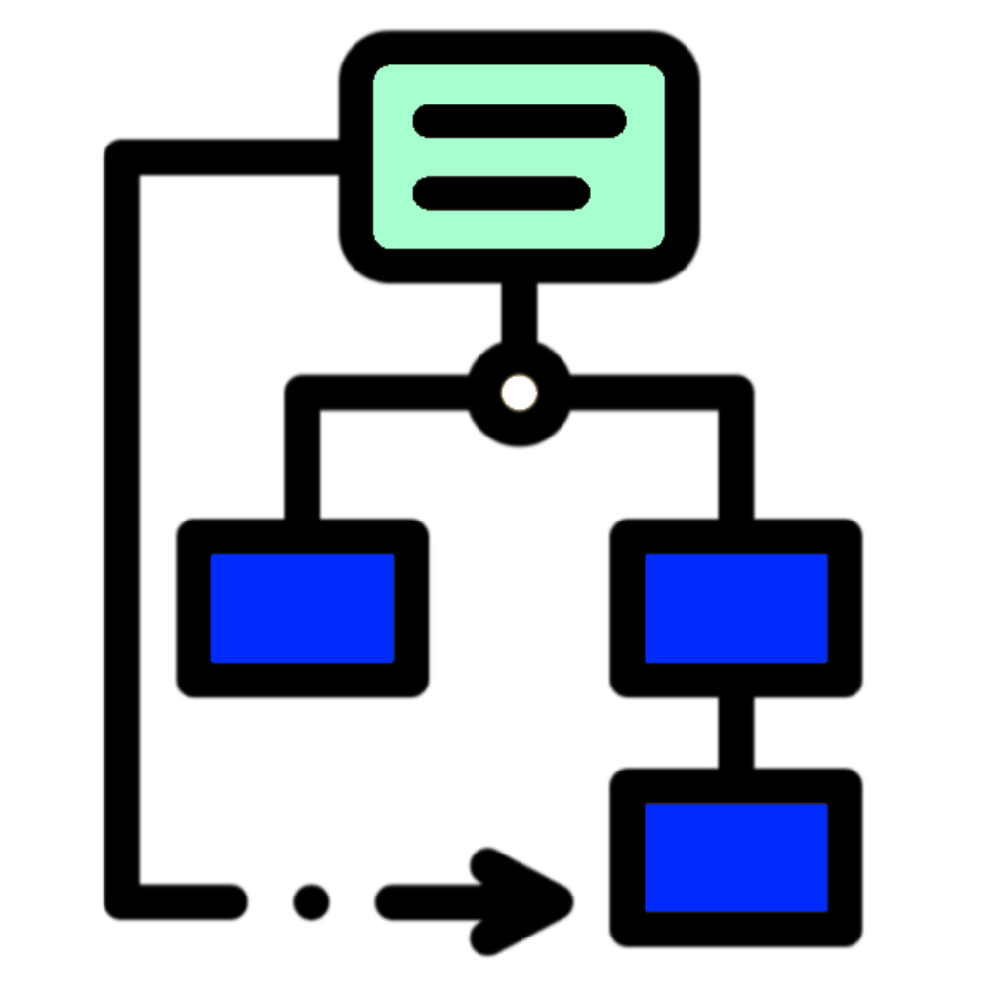
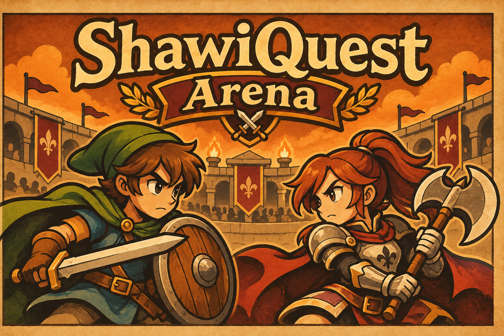

<h4 align="center">1SY – Analyse objet</h4>

# Simulation fonctionnelle d’un jeu de rôle en mode duel (v0.8)

## Mandat

Deux joueurs s’affrontent à tour de rôle sur la même console. Créez deux instances distinctes de la classe `Player`. Chaque joueur possède ses propres points de vie (HP) et sa propre arme. La même logique de jeu s’applique aux deux combattants.

Après avoir conçu le diagramme de classes, développez le jeu complet avec trois armes (Quel’Serrar, Arcanite Reaper et Shadowmourne) et trois enchantements (Fiery Weapon, Berserking et Crusader). Chaque arme possède sa propre stratégie d’attaque. Vous pouvez appliquer un ou plusieurs enchantements à chaque attaque.

L’évaluation porte sur le fonctionnement du jeu et sur votre utilisation des patrons de conception. Vous devrez notamment expliquer comment votre conception permet d’ajouter une arme, un enchantement ou une réaction au résultat d’une attaque.

Les probabilités de réussite, le calcul des dégâts et le cumul des effets suivent les règles de ce travail pratique.

> ⚠️ Le jeu doit lire toutes les valeurs numériques indiquées dans cet énoncé à partir de la classe de configuration `GameSettings`.

## 1. Classes à utiliser au minimum

### Classes de structure

| Classe | Patron ou rôle | Responsabilité |
|---|---|---|
| `Main` | Algorithme principal | Crée les deux joueurs et gère l’alternance des tours. À chaque tour, équipe le joueur actif de l’arme choisie, prépare l’attaque et ses enchantements avec `AttackBuilder`, puis appelle `Player.Attack`. |
| `Player` | Objet observable | Conserve le nom du joueur, ses HP, son arme équipée et sa réserve personnelle d’enchantements. Déclenche l’attaque représentée par l’objet `Attack` et en applique les effets à l’adversaire à l’aide de la méthode `ManageAttack`. |
| `AttackBuilder` | [Constructeur (*Builder*)](https://refactoring.guru/design-patterns/builder) | Prépare une attaque pour le joueur actif. La méthode `UseEnchantment` ajoute l’enchantement choisi si une charge est disponible, puis renvoie `this` pour permettre le chaînage des appels. La méthode `Build` construit et renvoie un objet `Attack`. |
| `Attack` | Données de l’attaque | Conserve l’arme choisie avec ses enchantements, ainsi que la force initiale `S`. Transmet également le résultat final de l’attaque aux composants concernés. |
| `GameSettings` | Classe statique | Regroupe toutes les constantes du jeu. Utilisez cette classe pour paramétrer le jeu. |

### Liste des armes

| Classe | Patron | Probabilité de réussite | Dégâts en cas de réussite |
|---|---|---:|---|
| `QuelSerrar` | Stratégie (*Strategy*) | 100 % | Cette épée touche sa cible à chaque attaque. Elle inflige des dégâts égaux à la force initiale `S`. |
| `ArcaniteReaper` | Stratégie (*Strategy*) | 50 % | Ajoutez à la force initiale `S` un bonus égal à 50 % de cette force. |
| `Shadowmourne` | Stratégie (*Strategy*) | 33 % | Augmentez la force initiale `S` d’un pourcentage égal au pourcentage de HP restants de la cible. Lorsque la cible possède tous ses HP, le bonus est de 100 % et l’arme inflige le double de la force initiale. |

### Liste des enchantements

| Classe | Patron | Responsabilité |
|---|---|---|
| `WeaponDecorator` | Décorateur abstrait | Fournit la structure commune qui permet d’envelopper une arme ou un autre décorateur. |
| `Fiery` | Décorateur concret | Ajoute 5 points aux dégâts calculés par l’arme ou le décorateur précédent. |
| `Berserking` | Décorateur concret | Augmente de 25 % les dégâts calculés par l’arme ou le décorateur précédent. |
| `Crusader` | Décorateur concret | Porte les dégâts à 30 si le résultat obtenu à cette étape est inférieur à 30. |

### Liste des observateurs

| Classe | Patron | Responsabilité |
|---|---|---|
| `UIDisplay` | Observateur (*Observer*) | Reçoit le résultat de l’attaque dans un objet `Attack` et l’affiche à l’écran. |
| `FightLogger` | Observateur (*Observer*) | Reçoit le résultat de l’attaque dans un objet `Attack` et le consigne dans un fichier. |

## 2. Déroulement d’une partie complète

### Configurer les deux participants

Avant le premier tour, configurez d’abord `player`, puis `opponent`. Demandez le nom de chaque participant.

Pour un joueur humain, recueillez ses choix au clavier. Pour un joueur contrôlé par l’ordinateur, le programme choisit au hasard une arme et une combinaison valide d’enchantements parmi ceux qui sont disponibles, puis confirme automatiquement ses choix. Affichez ces choix pour que les participants puissent suivre le duel.

Une fois les choix confirmés, résolvez l’attaque contre l’adversaire. Selon l’arme choisie, l’attaque peut échouer. Affichez le résultat de chaque attaque. Dès que les HP de la cible atteignent zéro, annoncez le gagnant et terminez le duel. Les HP ne peuvent jamais devenir négatifs. Si les deux joueurs sont encore en vie, inversez leurs rôles. L’adversaire dispose alors d’un tour complet pour préparer sa propre attaque.

<!--
### Durée d’un duel entre deux ordinateurs

Visez **10 tours de jeu en moyenne pour une durée totale d’environ 30 secondes**. Un tour correspond à l’action d’un seul joueur. Le duel prend fin dès que les HP d’un joueur atteignent zéro, que ce soit avant ou après le dixième tour.

À chaque tour du duel automatique, l’ordinateur choisit une arme au hasard selon les poids suivants : 5 pour Quel’Serrar, 1 pour Arcanite Reaper et 1 pour Shadowmourne. Tant que la réserve commune contient des charges, l’ordinateur a 10 % de chances d’enchanter son arme. Dans ce cas, il choisit au hasard le nombre d’effets à appliquer. Chaque nombre, de 1 jusqu’au maximum permis par les charges restantes et la limite par attaque, a la même probabilité d’être choisi. L’ordinateur tire ensuite chaque effet indépendamment parmi les trois types d’enchantements. Un même type peut donc être choisi plusieurs fois.

Affichez les choix de l’ordinateur, **attendez 3 secondes**, puis résolvez l’attaque et affichez son résultat.
-->

### Préparer une attaque

À chaque tour, le joueur peut changer d’arme, ajouter des enchantements ou lancer immédiatement une attaque avec l’arme qu’il a en main.

Au moment de créer l’attaque, déterminez au hasard sa force initiale `S` (*Strength*), **entre 10 et 20 inclusivement**.

Chaque joueur commence la partie avec une réserve personnelle de **trois charges de chaque type d’enchantement**. Lorsqu’un joueur a épuisé sa réserve, il poursuit le combat avec ses armes sans enchantement.

Au début de la préparation, affichez l’arme équipée sans enchantement. Le joueur peut choisir **de zéro à trois enchantements par tour**. Il peut combiner des effets différents ou choisir deux ou trois fois le même effet. Appliquez les effets un à un, dans l’ordre choisi.

Avant de lancer son attaque, le joueur doit pouvoir en recommencer la préparation autant de fois qu’il le souhaite.

### Réagir aux attaques

Aucun mécanisme de défense n’est à programmer dans ce travail pratique. Lorsqu’une attaque réussit, le joueur qui la subit perd la totalité des points de vie correspondant aux dégâts infligés, jusqu’à un minimum de zéro HP. La méthode `HandleAttack` avise les observateurs du résultat de l’attaque.

## 3. Remise

Remettez une archive ZIP comprenant les éléments suivants.

1. **Projet Visual Studio Code** — Incluez les fichiers sources nécessaires ainsi que les fichiers de configuration du dossier `.vscode`. Vérifiez que le projet se compile et démarre après l’extraction de l’archive.
2. **Diagramme de classes UML** — Présentez les classes et les interfaces qui participent aux patrons de conception, ainsi que leurs relations. Fournissez un diagramme lisible au format SVG.
3. **Fichier `README.md`** — Pour chaque patron de conception, nommez les classes concernées et expliquez comment elles collaborent pour produire le résultat attendu.

<!--
### Grille de correction

| Critère | Éléments évalués | Points |
|---|---|---:|
-->

